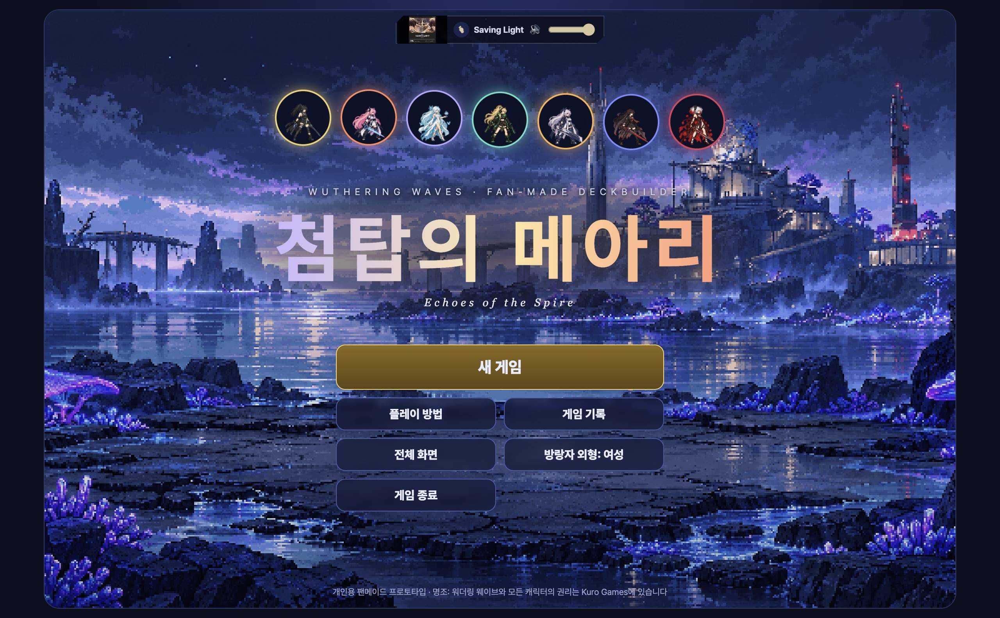
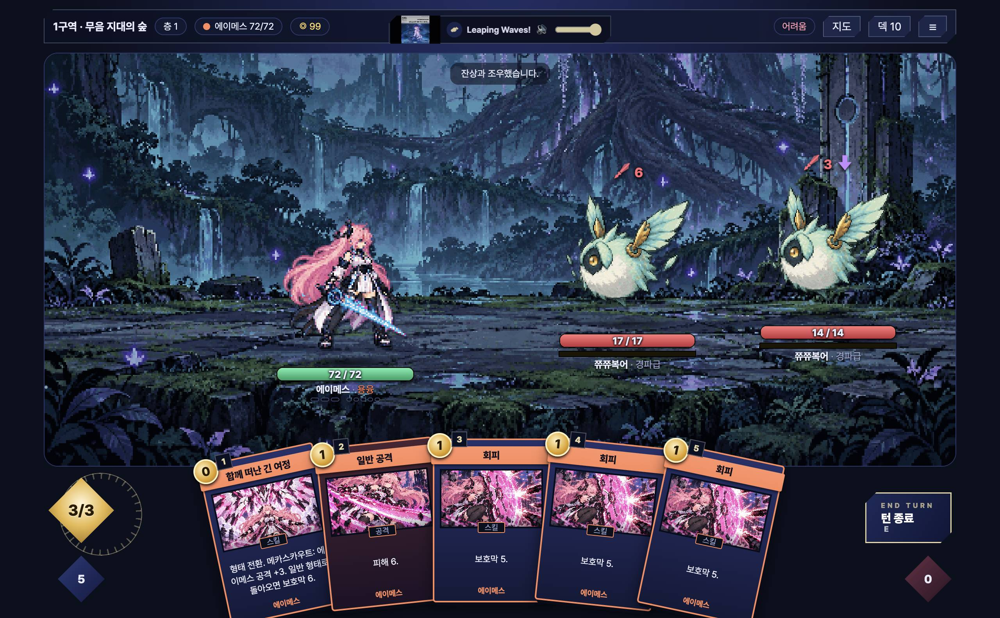
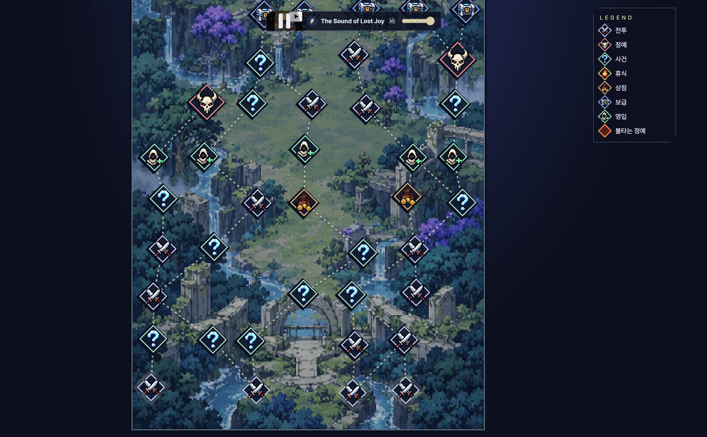

<div align="center">

# 첨탑의 메아리 · Echoes of the Spire

**명조: 워더링 웨이브 × 슬레이 더 스파이어** 팬메이드 덱빌딩 로그라이크

[](../../releases/latest)




</div>

> 개인 학습·플레이용 비공개 프로토타입이에요. 명조와 모든 캐릭터의 권리는 Kuro Games에 있어요.

---

## 🎮 3분 만에 시작하기

### 1. 파일 받기

[**Releases → 최신 버전**](../../releases/latest) 맨 아래 **Assets**에서 내 컴퓨터에 맞는 파일 하나만 받으세요.

| 내 컴퓨터 | 받을 파일 |
|---|---|
| 윈도우 (설치해서 쓰기) | `SpireOfEchoes-x.y.z-win-setup.exe` |
| 윈도우 (설치 없이 바로) | `SpireOfEchoes-x.y.z-win-portable.exe` |
| 맥 · Apple 실리콘 (M1~M4) | `SpireOfEchoes-x.y.z-mac-arm64.dmg` |
| 맥 · 인텔 | `SpireOfEchoes-x.y.z-mac-x64.dmg` |

> 맥 종류 확인: 화면 왼쪽 위 Apple 메뉴 → **이 Mac에 관하여** → "칩"이 Apple M이면 arm64, Intel이면 x64.

### 2. 실행하기

<details open>
<summary><b>윈도우</b></summary>

1. `win-setup.exe`를 실행해 설치해요. 끝나면 **바탕화면 아이콘**과 **시작 메뉴**가 생기고 게임이 바로 켜져요.
2. 파란 **"Windows의 PC 보호"** 창이 뜨면 **추가 정보 → 실행**을 눌러요. (처음 한 번만)

</details>

<details open>
<summary><b>맥</b></summary>

1. `.dmg`를 열고 **Spire of Echoes** 아이콘을 **Applications** 폴더로 끌어다 놓아요.
2. 응용 프로그램에서 **Spire of Echoes**를 열어요. "확인되지 않은 개발자" 창이 뜨면 **완료**를 눌러요.
3. **시스템 설정 → 개인정보 보호 및 보안** 맨 아래의 **그래도 열기**를 누르고 한 번 더 확인해요. (처음 한 번만)

<sub>그래도 안 열리면 터미널에서 `xattr -cr "/Applications/Spire of Echoes.app"` 를 한 번 실행하세요.</sub>

</details>

> 🌐 배경음악은 공식 유튜브 OST를 불러와서 **인터넷 연결**이 있으면 좋아요. 없어도 게임은 돼요.

---

## 🕹️ 조작법

| 하고 싶은 것 | 방법 |
|---|---|
| 카드 사용 | 카드를 **끌어서** 적(공격) 또는 무대(스킬)에 놓기 · 숫자키 `1`~`9` |
| 턴 종료 | **턴 종료** 버튼 · `E` |
| 에코 스킬 | 에너지 위 마름모 버튼 · `Q` |
| 공명자 교체 | 대기 중인 공명자 클릭 |
| 카드 병합 | 같은 카드 2장 위 **⧉ 병합** 버튼 · `M` |
| 약제(포션) | 상단 동그란 슬롯 클릭 · 우클릭으로 버리기 |
| 멀티 | 타이틀 **멀티 · 방 만들기**(호스트) / **멀티 · 참가**(손님) |
| 일시정지 · 메뉴 | `Esc` |

처음이라면 타이틀의 **플레이 방법**에 그림 설명이 있어요.

---

## ✨ 게임 소개



- **공명자 7명** — 방랑자 · 에이메스 · 린네 · 모니에 · 치사(라하이로이) · 파수인 · 카멜리아(검은해안)
- **한 명으로 시작** — 탑을 오르며 동료를 영입해 최대 3인 파티
- **협주 → 변주** — 카드 3장으로 협주 에너지를 채우고 교체하면 두 스킬이 연속 발동
- **공진 파괴** — 진동 게이지를 채우면 적이 한 턴 무력화, 받는 피해 +50%
- **운 요소** — 치명타(8%), 매 턴 **조수 룰렛**(해류·만조·역류·소용돌이·★황금 조수 잭팟), 변이 잔상(황금·거대·재생·광폭·결정 껍질·불안정 연쇄 폭발)
- **편성 랜덤** — 잔상 무리, 쌍두 정예, 정예와 졸개, 명식과 호위, 쌍둥이 명식
- **명조식 전투** — 속성 이상(회절 → 회절 잔향, 인멸 → 해체, 용융 → 용융 폭발 4중첩 시 터짐), 완벽 회피(보호막으로 다 막으면 반격 + 협주), 에코 소나타(같은 속성 에코 2·4세트 효과)
- **카드 조합** — 한 턴에 쓴 카드 3장의 종류 순서(공격·스킬)가 레시피와 맞으면 추가 효과(검무·반격 태세·연타·화음 등 6종). 두 공명자 카드가 섞이면 합주 ×1.5. 무대 왼쪽 위 「조합」 막대에 다음 카드 힌트
- **번뜩임** — 강화 안 된 카드를 쓸 때 8% 확률(전투당 1번)로 덱의 그 카드가 영구 강화
- **카드 병합** — 손의 같은 카드 2장을 융합(수치 ×1.5)
- **3구역** — 잠긴 해안 → 별빛 첨탑 → 심연의 정점, 최종 명식 「종언의 명식 · 무명의 노래」
- **약제 15종** — 슬롯 3개, 전투 보상·상점·사건에서 획득
- **에코 49개 · 사건 21개 · 승천 10단계** (클리어할 때마다 다음 승천 해금)
- **멀티(같은 와이파이 협동)** — 호스트 앱이 방을 열면 손님은 브라우저나 앱으로 `http://<호스트 IP>:7777/?guest` 접속해 같은 파티를 함께 조작
- **에코 · 무기** — 정예·명식에게서 에코를 흡수하고, 무기를 장착해 빌드를 완성
- **적** — 잔상이 일반·정예로, 명식(레비아탄 · 알레프-원의 창조물)이 보스로 등장
- **자동 저장** — 지도에 있을 때마다 저장돼서 타이틀 **이어하기**로 계속. 끝난 판은 타이틀 **게임 기록**에서 승률·최고 기록 확인
- **난이도** — 보통(적 체력·피해 110%) · 어려움(125%/120%) · 악몽(140%/135%)



---

## 🛠️ 개발자용

<details>
<summary>로컬 실행 · 빌드 · 배포</summary>

```bash
npm install
npm start            # 실행
npm run dist:mac     # 맥 빌드
npm run dist:win     # 윈도우 빌드
```

브라우저로 `index.html`을 열어도 플레이할 수 있어요.

**배포**: `package.json`의 `version`을 올리고 같은 번호로 태그를 올리면 GitHub Actions가 Releases에 설치 파일을 올려요.

```bash
git tag v0.7.1 && git push origin v0.7.1
```

**자가 점검**: `npx electron . --remote-debugging-port=9334` 실행 중 `node scripts/selfcheck.cjs`

**디자인 규칙**: [DESIGN.md](DESIGN.md) (명조풍 토큰·부품)

**이미지 교체**: `assets/`에 도트를 넣으면 자동 적용돼요. 규칙은 [assets/README.md](assets/README.md). 원작 색 보정은 `node scripts/recolor.cjs <캐릭터id>` (원본은 `art/backup-recolor/`).

</details>
