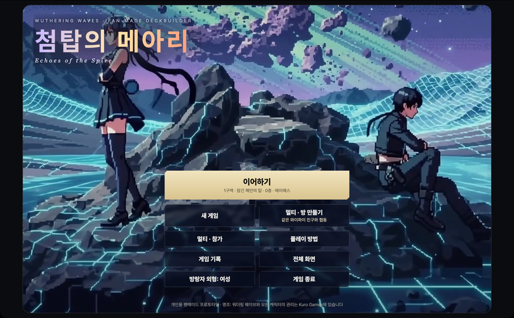
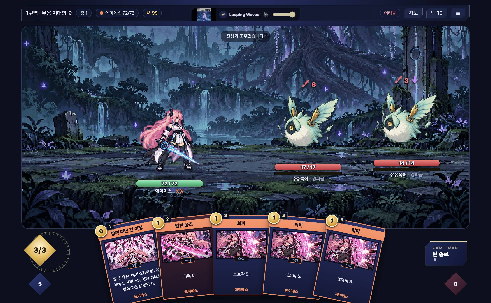
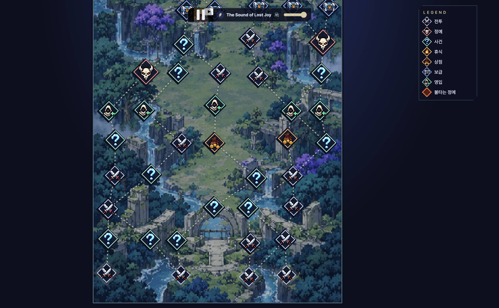
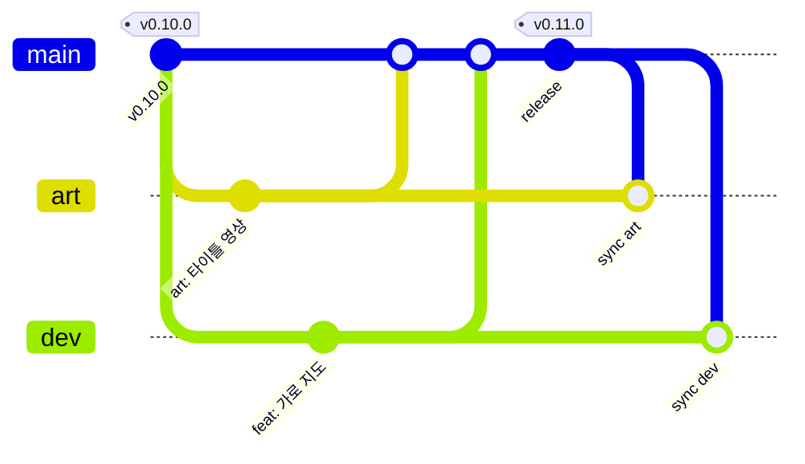

<div align="center">

# 첨탑의 메아리 · Echoes of the Spire

**명조: 워더링 웨이브 × 슬레이 더 스파이어** 팬메이드 덱빌딩 로그라이크

[](../../releases/latest)


[](../../actions/workflows/build.yml)



</div>

> 비상업 개인 팬메이드 프로토타입이에요(공개 저장소, 판매·수익 없음). 명조와 모든 캐릭터의 권리는 Kuro Games에 있어요.

---

## 🎮 3분 만에 시작하기

### 1. 파일 받기

[**Releases → 최신 버전**](../../releases/latest) 맨 아래 **Assets**에서 내 컴퓨터에 맞는 파일 하나만 받으세요.

| 내 컴퓨터 | 받을 파일 |
|---|---|
| 윈도우 (설치해서 쓰기) | `SpireOfEchoes-x.y.z-win-setup.exe` |
| 윈도우 (설치 없이 바로) | `SpireOfEchoes-x.y.z-win-portable.exe` |
| 맥 · Apple 실리콘 (M1~M4) | `SpireOfEchoes-x.y.z-mac-arm64.dmg` |
| 맥 · 인텔 | `SpireOfEchoes-x.y.z-mac-x64.dmg` |

> 맥 종류 확인: 화면 왼쪽 위 Apple 메뉴 → **이 Mac에 관하여** → "칩"이 Apple M이면 arm64, Intel이면 x64.

### 2. 실행하기

<details open>
<summary><b>윈도우</b></summary>

1. `win-setup.exe`를 실행해 설치해요. 끝나면 **바탕화면 아이콘**과 **시작 메뉴**가 생기고 게임이 바로 켜져요.
2. 파란 **"Windows의 PC 보호"** 창이 뜨면 **추가 정보 → 실행**을 눌러요. (처음 한 번만)

</details>

<details open>
<summary><b>맥</b></summary>

1. `.dmg`를 열고 **Spire of Echoes** 아이콘을 **Applications** 폴더로 끌어다 놓아요.
2. 응용 프로그램에서 **Spire of Echoes**를 열어요. "확인되지 않은 개발자" 창이 뜨면 **완료**를 눌러요.
3. **시스템 설정 → 개인정보 보호 및 보안** 맨 아래의 **그래도 열기**를 누르고 한 번 더 확인해요. (처음 한 번만)

<sub>그래도 안 열리면 터미널에서 `xattr -cr "/Applications/Spire of Echoes.app"` 를 한 번 실행하세요.</sub>

</details>

> 🌐 배경음악은 공식 유튜브 OST를 불러와서 **인터넷 연결**이 있으면 좋아요. 없어도 게임은 돼요.

---

## 🕹️ 조작법

| 하고 싶은 것 | 방법 |
|---|---|
| 카드 사용 | 카드를 **끌어서** 적(공격) 또는 무대(스킬)에 놓기 · 숫자키 `1`~`9` |
| 턴 종료 | **턴 종료** 버튼 · `E` |
| 에코 스킬 | 에너지 위 마름모 버튼 · `Q` |
| 공명자 교체 | 대기 중인 공명자 클릭 |
| 카드 병합 | 같은 카드 2장 위 **⧉ 병합** 버튼 · `M` |
| 약제(포션) | 상단 동그란 슬롯 클릭 · 우클릭으로 버리기 |
| 멀티 | 타이틀 **멀티 · 방 만들기**(호스트) / **멀티 · 참가**(손님) |
| 일시정지 · 메뉴 | `Esc` |

처음이라면 타이틀의 **플레이 방법**에 그림 설명이 있어요.

---

## ✨ 게임 소개



- **공명자 8명** — 방랑자 · 에이메스 · 린네 · 모니에 · 치사(라하이로이) · 파수인 · 카멜리아(검은해안) · 히유키(응결, 서리를 쌓아 빙결)
- **한 명으로 시작** — 탑을 오르며 동료를 영입해 최대 3인 파티
- **협주 → 변주** — 카드 3장으로 협주 에너지를 채우고 교체하면 두 스킬이 연속 발동
- **공진 파괴** — 진동 게이지를 채우면 적이 한 턴 무력화, 받는 피해 +50%
- **운 요소** — 치명타(8%), 매 턴 **조수 룰렛**(해류·만조·역류·소용돌이·★황금 조수 잭팟), 변이 잔상(황금·거대·재생·광폭·결정 껍질·불안정 연쇄 폭발)
- **편성 랜덤** — 잔상 무리, 쌍두 정예, 정예와 졸개, 명식과 호위, 쌍둥이 명식
- **명조식 전투** — 속성 이상(회절 → 회절 잔향, 인멸 → 해체, 용융 → 용융 폭발 4중첩 시 터짐, 응결 → 서리 4중첩 시 빙결), 완벽 회피(보호막으로 다 막으면 반격 + 협주), 에코 소나타(같은 속성 에코 2·4세트 효과)
- **카드 조합** — 한 턴에 쓴 카드 3장의 종류 순서(공격·스킬)가 레시피와 맞으면 추가 효과(검무·반격 태세·연타·화음 등 6종). 두 공명자 카드가 섞이면 합주 ×1.5. 무대 왼쪽 위 「조합」 막대에 다음 카드 힌트
- **번뜩임** — 턴 시작에 30% 확률로 손패 한 장이 빛나요. 그 카드를 쓰면 효과 3개 중 하나를 골라 덱의 카드를 영구히 바꿔요(전투당 1번, 카드당 1번)
- **카드 병합** — 손의 같은 카드 2장을 융합(수치 ×1.5)
- **3구역** — 잠긴 해안 → 별빛 첨탑 → 심연의 정점, 최종 명식 「종언의 명식 · 무명의 노래」
- **약제 15종** — 슬롯 3개, 전투 보상·상점·사건에서 획득
- **에코 49개 · 사건 21개 · 승천 10단계** (클리어할 때마다 다음 승천 해금)
- **멀티(같은 와이파이 협동)** — 호스트 앱이 방을 열면 손님은 브라우저나 앱으로 `http://<호스트 IP>:7777/?guest` 접속해 같은 파티를 함께 조작
- **에코 · 무기** — 정예·명식에게서 에코를 흡수하고, 무기를 장착해 빌드를 완성
- **적** — 잔상이 일반·정예로, 명식(레비아탄 · 알레프-원의 창조물)이 보스로 등장
- **자동 저장** — 지도에 있을 때마다 저장돼서 타이틀 **이어하기**로 계속. 끝난 판은 타이틀 **게임 기록**에서 승률·최고 기록 확인
- **난이도** — 보통(적 체력·피해 110%) · 어려움(125%/120%) · 악몽(140%/135%)
- **움직이는 타이틀** — 별하늘과 빛줄기가 흐르는 도트 영상 배경(소리 없이 끊김 없이 반복)
- **선명한 도트** — 1080p부터 4K까지 캐릭터·배경을 정수 배율로 키워 픽셀이 고르게 보여요(전투 배경 640×360 도트)



---

## 🛠️ 개발자용

<details>
<summary>로컬 실행 · 빌드 · 배포</summary>

```bash
npm install
npm start            # 실행
npm run dist:mac     # 맥 빌드
npm run dist:win     # 윈도우 빌드
```

브라우저로 `index.html`을 열어도 플레이할 수 있어요.

**브랜치**: 오래 쓰는 브랜치 3개만 둬요. 작업은 맞는 브랜치에서 하고, 합칠 때는 항상 `main`을 거쳐요(`art` ↔ `dev` 직접 병합 금지).

| 브랜치 | 용도 |
|---|---|
| `main` | 배포되는 기준. 공통 코드·문서·구조 |
| `art` | 그림·도트·프롬프트·에셋 도구 |
| `dev` | 기능·게임 규칙·오류 수정 |



| 하고 싶은 것 | 명령 |
|---|---|
| 세 브랜치 상태 한눈에(앞/뒤, push 안 한 것, 정리 후보) | `npm run branches` |
| 작업 시작 전: art·dev에 main 가져오기 | `npm run branches -- sync` |
| 작업 끝: art·dev를 main에 합치고 push | `npm run branches -- ship` |
| 배포: 버전 올리고 태그 push → 설치 파일·변경 내역 자동 등록 | `npm run branches -- release 0.12.0` |
| 릴리스 노트 미리보기 | `npm run release-notes -- v0.11.0` |

커밋 제목은 `feat:`(기능) · `fix:`(수정) · `art:`(그림) · `docs:`(문서) · `chore:`(정리)로 시작해요. 릴리스 노트가 이 말머리로 묶여요. `main`·`art`·`dev`는 강제 push와 삭제가 막혀 있어요.

**자가 점검**: `npx electron . --remote-debugging-port=9334` 실행 중 `node scripts/selfcheck.cjs` (VS Code 터미널에서는 앞에 `env -u ELECTRON_RUN_AS_NODE`). `mp_guard`는 7777 포트를 다른 프로그램이 쓰고 있으면 실패해요

**디자인 규칙**: [DESIGN.md](DESIGN.md) (명조풍 토큰·부품)

**코드 구조·브랜치·정리 규칙**: [docs/MAINTENANCE.md](docs/MAINTENANCE.md)

**프로젝트 문서**: [docs/README.md](docs/README.md)에서 설정·아트·시스템 문서를 찾을 수 있어요.

**이미지 교체**: 규칙은 [docs/art/ART_PIPELINE.md](docs/art/ART_PIPELINE.md), 파일 위치는 [assets/README.md](assets/README.md).

| 하고 싶은 것 | 명령 |
|---|---|
| 프롬프트 복사, 후보 그림 비교·적용 | `npm run board` |
| 공명자 도트 재처리(전원) | `node scripts/prepare-heroes-v3.cjs write` (한 명만: 앞에 `IDS=aem`, 미리보기: `write` 대신 `preview`) |
| 카드 시트도 다시 자르기 | 앞에 `CARDS=1`, 끝나면 `node scripts/cards.cjs import` (단품 카드 덮어쓰기 복구) |
| 카드 한 장 교체 | `art/card-gen/<카드ID>.png` 넣고 `node scripts/cards.cjs import` |
| 전투 배경 재처리 | `node scripts/prepare-battle-bg.cjs` |

예전 스크립트 2개(`prepare-sprites`, `prepare-art-v2`)는 덮어쓰기 방지로 막혀 있어요.

</details>
