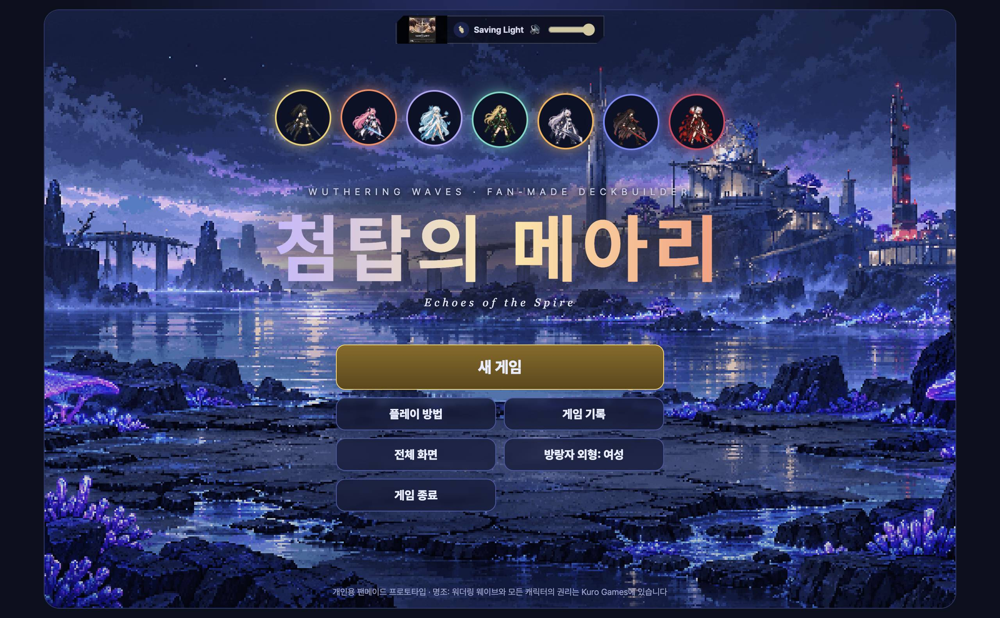
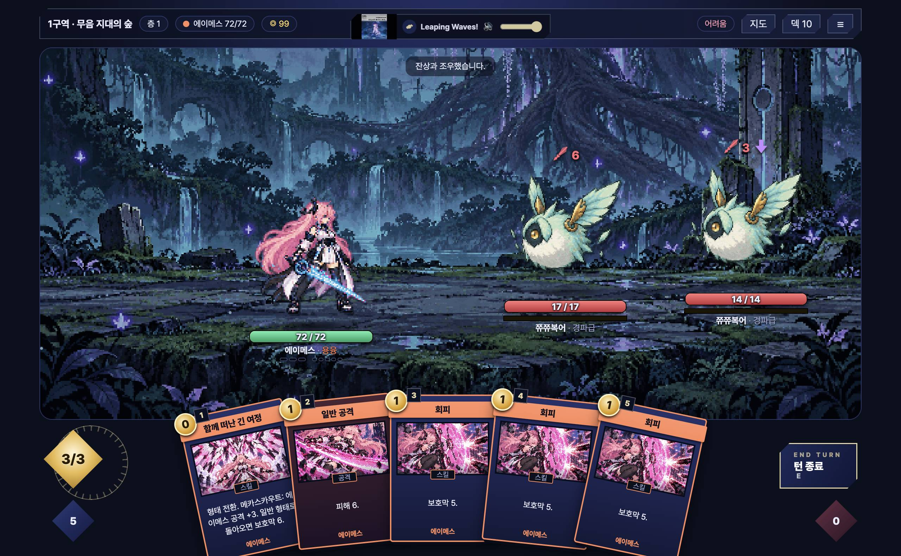
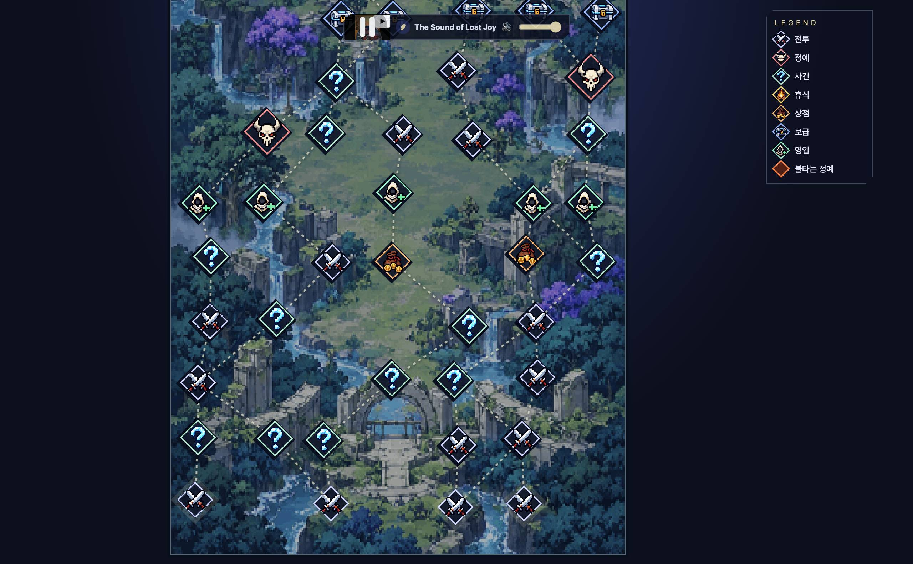

<div align="center">

# 첨탑의 메아리 · Echoes of the Spire

**명조: 워더링 웨이브 × 슬레이 더 스파이어** 팬메이드 덱빌딩 로그라이크

[](../../releases/latest)




</div>

> 개인 학습·플레이용 비공개 프로토타입이에요. 명조와 모든 캐릭터의 권리는 Kuro Games에 있어요.

---

## 🎮 3분 만에 시작하기

### 1. 파일 받기

[**Releases → 최신 버전**](../../releases/latest) 맨 아래 **Assets**에서 내 컴퓨터에 맞는 파일 하나만 받으세요.

| 내 컴퓨터 | 받을 파일 |
|---|---|
| 윈도우 (설치해서 쓰기) | `SpireOfEchoes-x.y.z-win-setup.exe` |
| 윈도우 (설치 없이 바로) | `SpireOfEchoes-x.y.z-win-portable.exe` |
| 맥 · Apple 실리콘 (M1~M4) | `SpireOfEchoes-x.y.z-mac-arm64.dmg` |
| 맥 · 인텔 | `SpireOfEchoes-x.y.z-mac-x64.dmg` |

> 맥 종류 확인: 화면 왼쪽 위 Apple 메뉴 → **이 Mac에 관하여** → "칩"이 Apple M이면 arm64, Intel이면 x64.

### 2. 실행하기

<details open>
<summary><b>윈도우</b></summary>

1. 받은 `.exe`를 더블클릭해요.
2. 파란 **"Windows의 PC 보호"** 창이 뜨면 **추가 정보 → 실행**을 눌러요. (코드 서명이 없는 개인 빌드라 처음 한 번 떠요)

</details>

<details open>
<summary><b>맥</b></summary>

1. `.dmg`를 열고 **Spire of Echoes** 아이콘을 **응용 프로그램** 폴더로 끌어다 놓아요.
2. **터미널**을 열고 아래 한 줄을 붙여 넣은 뒤 Enter. (처음 한 번만)

   ```bash
   xattr -cr "/Applications/Spire of Echoes.app"
   ```

3. 응용 프로그램에서 **Spire of Echoes**를 열어요.

</details>

> 🌐 배경음악은 공식 유튜브 OST를 불러와서 **인터넷 연결**이 있으면 좋아요. 없어도 게임은 돼요.

---

## 🕹️ 조작법

| 하고 싶은 것 | 방법 |
|---|---|
| 카드 사용 | 카드를 **끌어서** 적(공격) 또는 무대(스킬)에 놓기 · 숫자키 `1`~`9` |
| 턴 종료 | **턴 종료** 버튼 · `E` |
| 에코 스킬 | 에너지 위 마름모 버튼 · `Q` |
| 공명자 교체 | 대기 중인 공명자 클릭 |
| 일시정지 · 메뉴 | `Esc` |

처음이라면 타이틀의 **플레이 방법**에 그림 설명이 있어요.

---

## ✨ 게임 소개



- **공명자 7명** — 방랑자 · 에이메스 · 린네 · 모니에 · 치사(라하이로이) · 파수인 · 카멜리아(검은해안)
- **한 명으로 시작** — 탑을 오르며 동료를 영입해 최대 3인 파티
- **협주 → 변주** — 카드 3장으로 협주 에너지를 채우고 교체하면 두 스킬이 연속 발동
- **공진 파괴** — 진동 게이지를 채우면 적이 한 턴 무력화, 받는 피해 +50%
- **에코 · 무기** — 정예·명식에게서 에코를 흡수하고, 무기를 장착해 빌드를 완성
- **적** — 잔상이 일반·정예로, 명식(레비아탄 · 알레프-원의 창조물)이 보스로 등장
- **자동 저장** — 지도에 있을 때마다 저장돼서 타이틀 **이어하기**로 계속. 끝난 판은 타이틀 **게임 기록**에서 승률·최고 기록 확인
- **난이도** — 보통 · 어려움 · 악몽



---

## 🛠️ 개발자용

<details>
<summary>로컬 실행 · 빌드 · 배포</summary>

```bash
npm install
npm start            # 실행
npm run dist:mac     # 맥 빌드
npm run dist:win     # 윈도우 빌드
```

브라우저로 `index.html`을 열어도 플레이할 수 있어요.

**배포**: `package.json`의 `version`을 올리고 같은 번호로 태그를 올리면 GitHub Actions가 Releases에 설치 파일을 올려요.

```bash
git tag v0.7.1 && git push origin v0.7.1
```

**자가 점검**: `npx electron . --remote-debugging-port=9334` 실행 중 `node scripts/selfcheck.cjs`

**이미지 교체**: `assets/`에 도트를 넣으면 자동 적용돼요. 규칙은 [assets/README.md](assets/README.md). 원작 색 보정은 `node scripts/recolor.cjs <캐릭터id>` (원본은 `art/backup-recolor/`).

</details>
